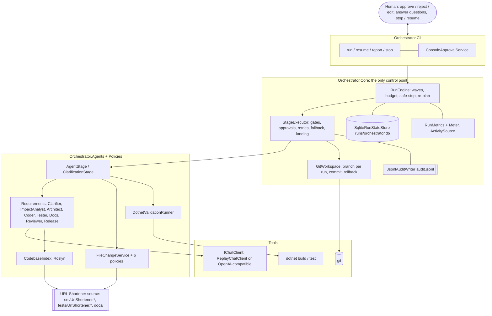
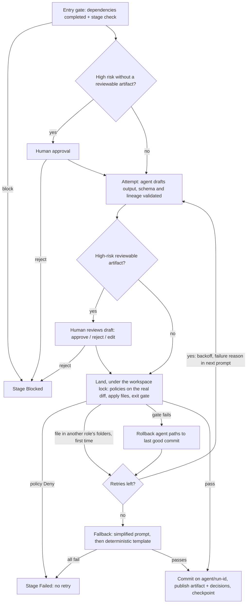

# Architecture

Two systems in one solution (SDK 9.0.305, `net8.0`, C# 12):

- **The orchestrator** turns a requirement into a reviewed, tested, committed change by running
  agents through an explicit SDLC graph under human approval, policy and budget control.
- **The URL shortener** is the product the orchestrator builds (greenfield) and changes (brownfield).

The decisions behind the design are recorded as ADRs in [adr/](adr/); [assumptions.md](assumptions.md)
lists every interpretation of an ambiguous requirement.

## 1. Components

Agents never talk to the human, to each other, to git or to the file system directly. Every
request goes through the engine and every write through `FileChangeService`, which is where
gates, approvals, policies, retries and the audit trail live. That single control point is what
makes the autonomy "controlled".

| Project | Responsibility |
| --- | --- |
| Orchestrator.Core | Contracts (`IStage`, `IAgent`, `IApprovalService`, `IPolicy`, `Decision`), `RunContext`, scenario loading and DAG validation, `RunEngine`, `StageExecutor`, `Replanner`, `GitWorkspace`, `SqliteRunStateStore`, `JsonlAuditWriter`, `RunMetrics`, `UnifiedDiff`, telemetry |
| Orchestrator.Agents | `SdlcAgent` roles, `AgentStage`, `ClarificationStage`, `StageFactory`, `FileChangeService`, `DotnetValidationRunner`, `ReplayChatClient` / `OpenAiCompatibleChatClient`, `CodebaseIndex`, `OpenQuestions` |
| Orchestrator.Policies | Path allowlist, secret scan, NuGet allowlist, diff size, migration approval, vulnerable packages |
| Orchestrator.Cli | Composition root, Spectre.Console commands and approval prompt, `RunReport`, `LineageReport` |
| UrlShortener.* | The product, in Clean Architecture (section 7) |

## 2. Orchestration model

A **scenario** (`scenarios/*.yaml`) names the requirement, the stages (`id`, `agent`, `dependsOn`,
`risk`, optional `retry`/`budget`), a retry policy (1 to 3 attempts, exponential backoff) and a run
budget (minutes, tokens). The loader is strict: unknown or duplicate keys, cycles, unknown
dependencies and bad budgets are rejected before anything runs.

| Scenario | Graph |
| --- | --- |
| greenfield | requirements, design, then implement, tests and docs in parallel, then validate, release |
| brownfield | requirements, impact, design, then implement and docs in parallel, tests after implement, then validate, release |
| ambiguous | clarify, requirements, design, docs, validate, release |
| feature (live only) | the brownfield graph, with the requirement given on the command line (`--requirement "..."`) |

**Scheduling.** The engine runs in waves: every stage whose dependencies are complete starts at
once, and the wave is awaited with `Task.WhenAll`; validate is the join (ADR 0005). Model calls run
in parallel. Changes that touch the workspace (exit gates, commits, rollbacks) land one at a time
through a workspace lock, so each gate judges a tree made of already-passed changes plus one
proposal.

**Shared context.** `RunContext` carries the requirement, the frozen scenario, accepted artifacts
(each with a SHA-256 content hash), the decision lineage, budget usage, stage states, branch and
commits. Stages read it concurrently. Collections are concurrent or immutable, and every write
plus its SQLite checkpoint goes through one lock. The whole context is checkpointed after every
state change, so `resume <runId>` continues from the last safe point.

## 3. Control flow of one stage

- **Entry gate:** dependencies are completed with accepted artifacts, plus the stage's own check.
- **Exit gate:** the agent JSON is schema-valid, files sit inside the role's autonomy boundary,
  the policies pass, and for code-changing stages and the Reviewer, a real `dotnet build` plus
  `dotnet test` of the product test projects passes. Pass/fail counts, failing test names and
  compiler errors become the gate reason (and the next prompt's feedback). Logs are kept per
  attempt.
- **Retries:** Polly, at most 3 total attempts, exponential backoff, no jitter. Only attempt
  failures are retried; blocks, rejections, policy denials, cancellation and budget stops are not.
  One exception: a file in another role's folders (a Coder writing `tests/`) is retried once with
  the denial as feedback; a second one stops the stage (ADR 0011). The Architect's design groups
  files by the role that writes them, and the Coder is told to leave tests and docs to their roles.
- **Fallback:** one simplified-prompt attempt, then a deterministic template (read-only roles
  except the Reviewer, and Docs; Coder, Tester and Reviewer have no safe template), then the stage
  fails.
- **Binding review and rework:** the Reviewer must end with `Verdict: PASS` or `Verdict: FAIL`
  plus findings (its JSON also carries a `verdict` field, which completes a review whose content
  lacks the line), and "code that is never called does not meet a requirement". After the real
  build and tests pass, a FAIL still fails the validate gate (`review_failed`). The engine then
  marks the reviewed stages stale, with the findings as their re-plan reason, refreshes anything
  after them, and reviews again (`rework`), with its earlier findings so it checks each was fixed.
  At most two rework cycles run (`StageExecutor.MaxReworks`); a third FAIL fails the run. The
  Reviewer is asked to list every gap in one review, so a single cycle can fix them all. A failed review is reworked, not retried, since repeating the same review cannot fix the code.
  The first pass runs implement, tests and docs in parallel; a rework runs them one at a time in
  scenario order (`StageState.InRework`), so the tests and docs see the code fix they follow.
  The Docs agent also sees the files the run changed and updates its own document instead of adding
  a second one.
- **Red tests and validation rework:** new tests describe the requirement, so they may fail against
  code that does not meet it yet, or be wrong themselves. At the tests and implement gates, failures
  confined to test classes in files this run created (`RunContext.CreatedFiles`) may be "red" if the
  build and every existing test pass, so neither stage is blamed for the other's new tests; anything
  else is retried as before. The validate stage runs the full build and test suite before the Reviewer is asked, and
  gives the result to the Reviewer as the current state (earlier gate notes, such as "new tests are
  red", may predate later changes). It runs again at the exit gate. If either run fails, the engine reworks
  implement, tests and docs (the same rework cycles as a FAIL review) with the failing tests and
  their assertion messages as feedback, instead of blaming the tests. Gate reasons include the first
  failing tests with their messages and the source line that threw, so a Tester can see a bug in its
  own test.
- **Release recommendation:** the Release agent must state `Recommendation: READY` or
  `NOT READY`. It's shown as `[READY]` or `[NOT READY]` at the start of the summary in the release
  prompt; the decision stays with the human.
- **Rollback:** every failed gate resets the agent-writable paths to the last good commit:
  modified files are checked out, new files deleted. A `rollback` event lists the files. Files
  outside those paths are never touched (ADR 0005).

## 4. Control flow of a run

1. Load and validate the scenario. On resume, load the checkpoint and verify it against the scenario.
2. Check out `agent/run-<runId>`. This refuses dirty agent paths, staged changes or a repository
   with no commits. Write `input.md` and `plan.json`.
3. Arm safe-stop. One linked `CancellationTokenSource` combines the stop command or Ctrl+C, the
   time budget and the token budget.
4. Loop. Before each wave, **re-plan**:
   - compare each completed stage's reviewed draft file with its accepted artifact hash
   - re-land edited stages through their gates and approval
   - mark their downstream stages stale and regenerate them; keep everything else (ADR 0007)

   Then run the next wave. Stop at the first wave with a failed or blocked stage.
5. Finish: write `report.md` and `diff.patch` (from the base commit to the branch tip), and record metrics.
   A stop pauses instead: running stages become Interrupted, and the checkpoint keeps the reason.

## 5. Governance

| Needs a human | Mechanism |
| --- | --- |
| High-risk stages (requirements, impact, design, release; clarify) | approval before execution, or review of the draft (approve / reject / edit) |
| New EF Core migrations | MigrationApproval policy requires approval |
| New or changed NuGet packages | NuGetAllowlist (allowlisted packages need approval, others are denied); VulnerablePackages (unknown status needs approval, vulnerable is denied) |
| Diffs over 400 changed lines | DiffSize (over 2,000 lines is denied) |
| Build/config files, suspicious secret-looking values | PathAllowlist and SecretScan require approval |
| Ambiguous requirements | open-questions.md must be answered before any design |
| Release | Release stage is High risk; merging the run branch stays a manual step |

**Autonomy boundaries.** Each role declares allowed path roots and a token cap:
- Coder: `src/UrlShortener.*`
- Tester: `tests/UrlShortener.*`
- Docs: `docs`
- every other role: no files

The global path policy additionally denies everything outside the product roots and all
secret-bearing file types. Secret findings report `path:line` and never the value. A policy Deny
stops the stage without retrying (ADR 0006), except one correction for a file in another role's folders (ADR 0011).

**Budgets and safe-stop.** The time budget limits **machine time** in each engine session: a
`HumanWaitClock` times every approval (stage reviews and file-policy approvals alike, through
`HumanWaitApprovalService`), and a watcher compares elapsed time minus human waits with the budget.
Reading, editing and answering never use it up. The token budget is cumulative and charged from
model usage (default 600,000 per run). Exceeding either pauses the run cleanly (`run_paused`,
`budget_exceeded`). Because tokens count for the whole run, `resume <runId> --max-tokens <n>` lets
the person resuming raise the token budget; the change is audited (`token_budget_changed`, with
their name). `--auto-approve` is refused unless `CI=true`.

## 6. Observability: audit, lineage, metrics

- **Audit trail:** `runs/<runId>/audit.jsonl` is append-only, one JSON object per event:
  timestamp, W3C trace ID from `ActivitySource`, stage, agent, event, prompt hash, output hash,
  verdict, approver and message. Events cover gates, approvals, attempts, retries, fallbacks,
  rollbacks, policy checks, commits and re-plans. Prompts and artifact bodies are hashed, not
  copied.
- **Decision lineage:**
  - every agent decision names the newest current decision of each upstream stage as its parent
  - human edits and answers are decisions too, made by the approver
  - re-planned decisions are kept and marked superseded
  - `DecisionCommits` links decisions to the commits that landed them
  - `report <runId> --lineage` prints the tree from the requirement down to commits
- **Metrics:** `RunMetrics` derives everything from the audit log, so the numbers survive resumes:
  - success rate, retry rate, rollback frequency
  - MTTR (first failed attempt to the next completion of that stage)
  - end-to-end and per-stage latency
  - human wait time, kept apart from machine time

  `report.md` shows them per run and across all runs. Live counters and histograms are published
  on the `UrlShortenerAgentic.Orchestrator` Meter with low-cardinality tags.
- **Logs:** Serilog in the API; per-attempt `*.build.log` and `*.test.log` files for gates.

## 7. Specialised stages

- **Impact analysis (brownfield).** The ImpactAnalyst proposes seed types and members. The host
  grounds them in a Roslyn syntax-tree index of the current code and computes the affected files,
  endpoints (`Map*` calls with `MapGroup` prefixes), EF tables and tests. Unknown seeds are listed
  separately (ADR 0008).
- **Clarification (ambiguous).** The Clarifier writes `open-questions.md` with 2 to 3
  interpretations per question. The run pauses until every `Answer:` line is filled in, each
  answer becomes a decision, and changing an answer later re-plans downstream stages.
- **Replay.** `ReplayChatClient` serves `scenarios/recordings/<scenario>/<stage>.json`:
  - lookup order is `<stage>.<variant>.json` (simplified prompt), then `<stage>.attempt<N>.json`
    (scripted failures), then `<stage>.json`
  - a recording may hold prompt-matched variants, so replays follow human answers
  - no network and no key; a missing recording is an error, never a silent live call (ADR 0004)

**Live mode and code context.** For a new requirement, `run scenarios/feature.yaml --requirement "..."`
replaces the scenario's requirement (replay is refused, because it only knows the recorded demo
scenarios). A real model cannot change code it has never seen, so every agent shares a read-only
`CodeContext`, and each role declares what it needs (`SdlcAgent.Needs`):
- **Outline** (files, types, members, endpoints, tables; built from Roslyn syntax trees): the
  ImpactAnalyst, Architect, Coder and Tester, so plans and code name real types.
- **Current files**, in priority order:
  1. role defaults: for the Tester, the test fixture `ApiFactory.cs` and the API contract
     (`Contracts.cs`, `LinkEndpoints.cs`)
  2. product files named by path anywhere in the run's accepted artifacts
  3. files declaring a type the artifacts mention by name (a design that says "change LinkService"
     names no path)
  4. for the code roles (Architect, Coder, Tester, Reviewer): the rest of the product source under
     `src/`, without migrations, so a design that names nothing still shows where new code must be
     called from

  Given to the Architect, Coder, Tester, Docs and Reviewer, until the size budget runs out. The
  Reviewer first gets every file the run has landed so far (`RunContext.ChangedFiles`, persisted
  with the run), including test and docs files, so work from an earlier round still counts after a
  rework whose artifacts no longer name it. `docs/` is readable only when a file is asked for by name;
  it is never part of the outline or the whole-source view.

The Coder and Tester must return at least one file. An empty answer fails the attempt, with the
model's own explanation as retry feedback, instead of passing the gate with nothing done.

Reads are limited to product roots, with no `..` and no `bin`/`obj`, each file is capped at 24,000
characters and the total at 120,000. The workspace's absolute path is replaced with `<workspace>` in
everything sent, including failure feedback. Agents still write only through `FileChangeService`.
Role prompts state the project's conventions (stack, layering, UTC, ProblemDetails, no new packages,
how to write a migration and its snapshot). The live client explains setup errors (401, 404, 429,
with the provider's message), reports answers cut off at the output limit, and accepts JSON
wrapped in markdown fences. The model name is recorded in `plan.json`, the audit log
(`agent_requested`) and `report.md`.

## 8. URL shortener

Clean Architecture: Application depends on Domain, and Infrastructure and Api depend on Application. Domain references nothing.

- **Domain.**
  - `ShortLink` enforces code rules (3 to 30 of `[A-Za-z0-9_-]`, reserved `api`/`health`/`swagger`),
    absolute HTTP(S) targets up to 2,048 characters, expiry after creation, and UTC timestamps
  - `ClickEvent` accepts only a SHA-256 IP digest
  - `Base62CodeGenerator` draws seven characters with unbiased `RandomNumberGenerator.GetInt32`
- **Application.**
  - `LinkService` with FluentValidation; rejects targets that point back to this service
  - generated codes get up to three retries on collision
  - durable idempotency: the key plus a SHA-256 request fingerprint, inserted atomically with the link
- **Infrastructure.**
  - EF Core 8 + SQLite, one database file for links, clicks and idempotency records
  - unique index on `Code`, index on `(ShortLinkId, ClickedAtUtc)`, a foreign key restricting
    physical deletes
  - value converters restore UTC on read
  - `ClickCount` is incremented with `ExecuteUpdateAsync` in the same transaction as the event insert
- **Api.**
  - Minimal API endpoints with ProblemDetails errors
  - redirects read through a bounded `IMemoryCache` (striped locks coordinate eviction on delete)
  - clicks go to a bounded `Channel<ClickEvent>`; a `BackgroundService` stores them with up to
    three attempts
  - per-IP fixed-window rate limit on POST
  - liveness and readiness (database) health checks, Swagger, Serilog request logging
  - Development applies migrations at startup

Trade-offs: analytics are eventually consistent and can be lost on a crash, because the queue is
in memory (ADR 0002). Cache coherence assumes one process. There is no authentication, and no
trusted-proxy configuration for rate limiting.

## 9. Key decisions

| ADR | Decision |
| --- | --- |
| [0001](adr/0001-sqlite-utc-and-atomic-clicks.md) | UTC `DateTime` on SQLite and atomic click counting |
| [0002](adr/0002-api-idempotency-and-background-clicks.md) | Durable idempotency and background click ingestion |
| [0003](adr/0003-sequential-checkpoints-and-audit.md) | SQLite checkpoints and a JSONL audit trail (scheduling superseded by 0005) |
| [0004](adr/0004-replay-mode-and-live-chat-client.md) | Replay mode and a minimal live chat client |
| [0005](adr/0005-parallel-waves-landing-queue-and-branch-rollback.md) | Parallel waves, a landing queue and branch-per-run rollback |
| [0006](adr/0006-policy-guardrails-on-the-write-path.md) | Policy guardrails on the write path |
| [0007](adr/0007-artifact-hash-replanning-and-audit-derived-metrics.md) | Hash-based re-planning and audit-derived metrics |
| [0008](adr/0008-grounded-impact-analysis-and-human-answered-clarification.md) | Grounded impact analysis and human-answered clarification |
| [0009](adr/0009-custom-dag-engine-over-a-workflow-framework.md) | A custom DAG engine rather than a workflow framework |
| [0010](adr/0010-sqlite-only.md) | SQLite only, for the product and the orchestrator |
| [0011](adr/0011-one-correction-for-role-boundary-denials.md) | One correction for a write in another role's folders (amends 0006) |
